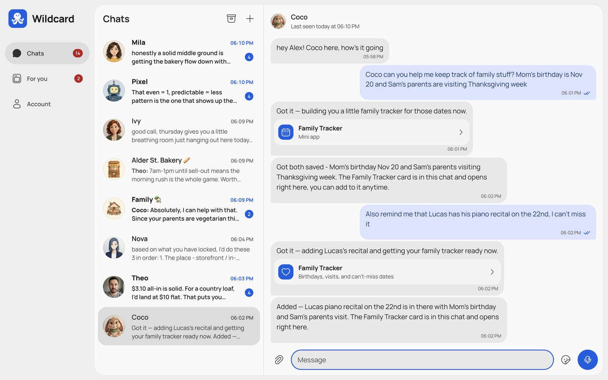
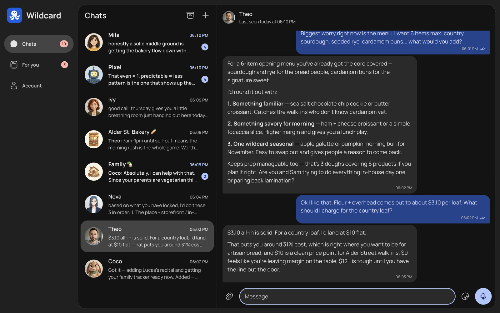
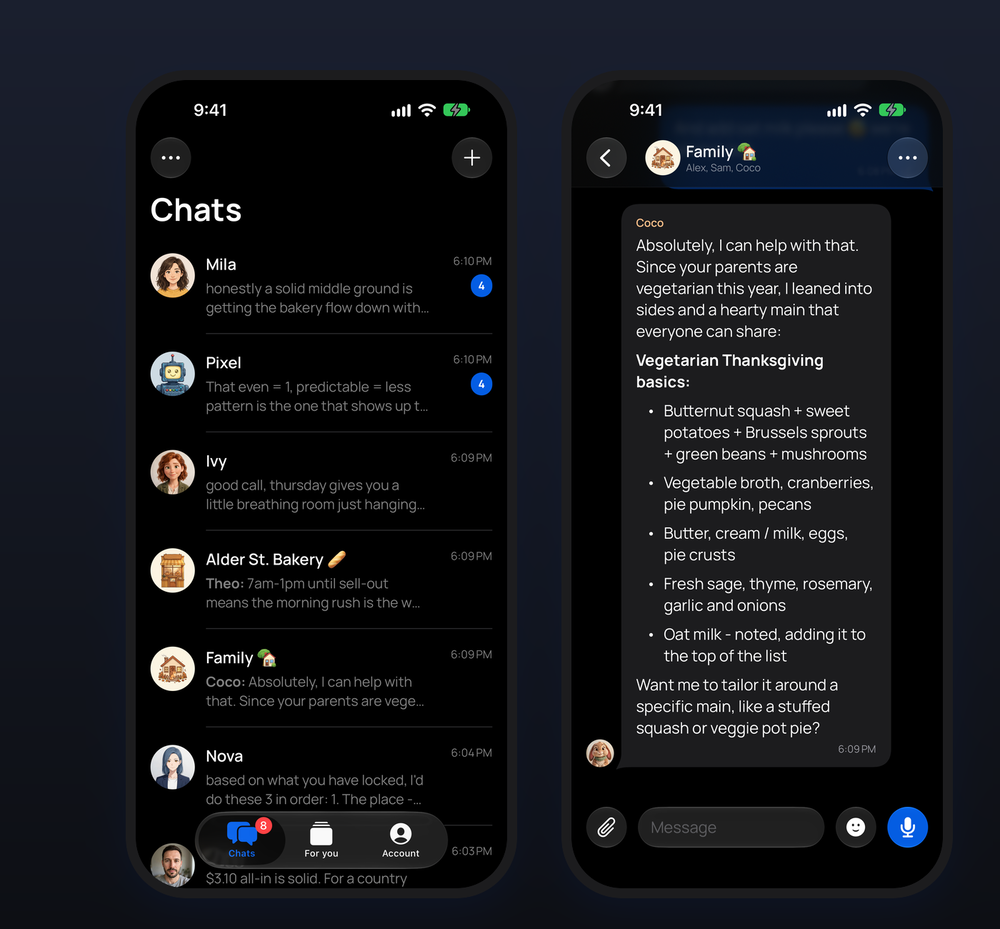
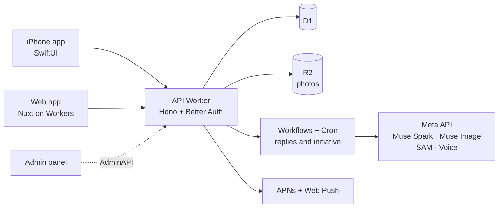

<p align="center">
  <a href="https://wildcard-site.imlautaro.workers.dev">
    
  </a>
</p>

<h1 align="center">Wildcard</h1>

<p align="center">
  <strong>AI contacts that text you first.</strong><br>
  A cast of AI contacts, each with their own name, face, personality and memory.<br>
  They reach out on their own, remember what matters, and join your chats with family and friends.
</p>

<p align="center">
  <a href="https://wildcard-web.imlautaro.workers.dev"><strong>Try it</strong></a> ·
  <a href="https://wildcard-site.imlautaro.workers.dev">Website</a> ·
  <a href="https://wildcard-docs.imlautaro.workers.dev/en">Docs</a> ·
  <!-- TODO: add the demo video link here once it is published -->
  <a href="https://wildcard-docs.imlautaro.workers.dev/es">Documentación en español</a>
</p>

<p align="center">
  
  
  
  <a href="LICENSE"></a>
</p>

<p align="center">
  
</p>

<p align="center">
  
  
  
  
  
  
  <br>
  <sub>Every portrait above was generated by the app's own contact generator.</sub>
</p>

## Chatbots wait. Contacts show up.

Most AI apps are one text box that answers when asked. Wildcard works like your phone's
contact list: different characters with their own lives, who keep the conversation going.

| | A typical AI chat | A Wildcard contact |
| --- | --- | --- |
| **Who starts** | Waits for you to type | Reaches out first, then gives you space |
| **Who you talk to** | One assistant for everything | A cast, each with a personality |
| **Memory** | One memory for every chat, or none | A separate memory for each contact |
| **Who's there** | Just you | Shared with family, friends and groups |

## Features

- 🧠 **One memory per contact.** Theo knows your bakery launch, Ivy knows your marathon plan, and neither brings up the other. Mark a chat private and nothing leaks out of it. → [Memory and privacy](https://wildcard-docs.imlautaro.workers.dev/en/features/memory-and-privacy)
- 💬 **They text first.** Follow-ups on the interview you mentioned, a thought they had later, a check-in after a quiet week. They wait when you don't answer. → [Initiative](docs/initiative.md)
- 🎨 **Create anyone.** Cartoon, anime, 3D, realistic, pets or your own style, with a generated portrait and 17 temperament sliders. → [Accounts and contacts](https://wildcard-docs.imlautaro.workers.dev/en/features/accounts-and-contacts)
- 👨‍👩‍👧 **Share a contact, keep your own chat.** Invite family or friends: each person gets a private chat, the contact remembers facts across them. → [Sharing](docs/sharing.md)
- 👥 **Groups.** Mix people and contacts in one chat; contacts organize projects and assign tasks. → [Groups](docs/groups.md)
- 📰 **For you.** A feed your contacts curate: notes, quotes and news on topics you follow. → [For you](https://wildcard-docs.imlautaro.workers.dev/en/features/for-you)
- 📸 **Photos, stickers and voice.** Contacts send selfies and images, cut stickers out of photos and understand voice messages. → [Media](https://wildcard-docs.imlautaro.workers.dev/en/features/media)
- 🔌 **Real work, per contact.** Web research, tasks, documents, reminders, MCP connectors (GitHub, Notion, Linear…) and native mini apps. → [Agentic work](https://wildcard-docs.imlautaro.workers.dev/en/features/agentic-work)

<table>
  <tr>
    <td width="50%"><br><sub><b>Catch me up.</b> Nova asks Theo for the context, so you don't repeat yourself.</sub></td>
    <td width="50%"><br><sub><b>For you.</b> A feed your contacts curate from what you talk about.</sub></td>
  </tr>
  <tr>
    <td width="50%"><br><sub><b>Mini apps.</b> Coco built a family tracker on its own, right in the chat.</sub></td>
    <td width="50%"><br><sub><b>Dark mode</b> on the web and on iPhone.</sub></td>
  </tr>
</table>

<p align="center">
  
</p>

<sub>Every contact, portrait, photo and message in these screenshots was generated live by the app with Meta models on a demo account.</sub>

## Built with Meta AI

Four Meta models through the Meta API, each with one job:

| Model | What it does in Wildcard |
| --- | --- |
| **Muse Spark 1.3** | Every reply, proactive message, memory update, group decision, web research, For you post and mini app |
| **Muse Image 1.0** | Contact portraits, selfies and images sent in chat |
| **SAM 3.1** | Cuts stickers out of photos |
| **Muse Voice Transcribe 1.0** | Turns voice messages into text the contact can answer |

→ [How Wildcard calls the models](https://wildcard-docs.imlautaro.workers.dev/en/cloudflare/ai)

## How it works



Everything runs on Cloudflare: Workers, D1, R2, Workflows and Cron. No servers to manage.
→ [Architecture](https://wildcard-docs.imlautaro.workers.dev/en/getting-started/architecture)

## Run it yourself

```bash
git clone https://github.com/imlautaro/wildcard && cd wildcard
npm ci
npm run auth:setup:local   # local auth secret + local D1 with every migration
npm run dev                # API on http://localhost:8787
npm run dev:web            # web app on http://localhost:3000
```

No Cloudflare account is needed locally: Wrangler emulates D1, R2 and Workflows. Add your own
`META_API_KEY` to `apps/api/.dev.vars` to generate replies.

Deploying to your own Cloudflare account, the iOS app and every environment variable are covered in
[Local development](https://wildcard-docs.imlautaro.workers.dev/en/getting-started/local-development)
and [Provisioning](https://wildcard-docs.imlautaro.workers.dev/en/operations/provisioning).

## Repository

| Path | What it is |
| --- | --- |
| [`apps/api`](apps/api) | Hono API Worker: auth, chats, contacts, Workflows |
| [`apps/web`](apps/web) | Nuxt web app |
| [`apps/ios`](apps/ios) | SwiftUI iPhone app, widgets, share and notification extensions |
| [`apps/admin`](apps/admin) | Super admin panel |
| [`apps/site`](apps/site) · [`apps/docs`](apps/docs) | Marketing site and documentation (English and Spanish) |
| [`packages/ui`](packages/ui) | Shared design system for web and admin |
| [`docs/`](docs) | In-depth design notes for every feature; start with the [developer guide](docs/README.md) |

## Meta AI Developer Hackathon

Wildcard was built for the [Meta AI Developer Hackathon](https://cerebralvalley.ai/e/meta-ai-developer-hackathon/details)
(October 26 – November 4, 2026), Indie Developer track. <!-- TODO: one line on what existed before the event, matching the video -->

## Contributing

Issues and pull requests are welcome. Start with the
[contributing guide](https://wildcard-docs.imlautaro.workers.dev/en/operations/contributing).

## License

[MIT](LICENSE). Bundled third-party assets keep their own terms: the Manrope font
is under the SIL Open Font License (`OFL.txt` next to each copy), the notification
sounds are from Mixkit under its license, and connector logos are trademarks of
their respective owners.
