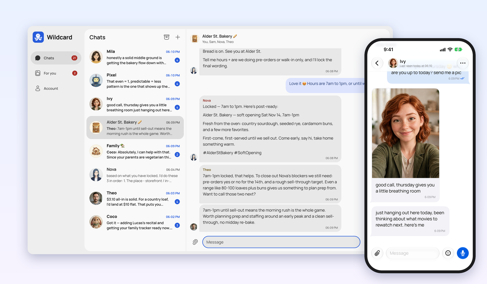
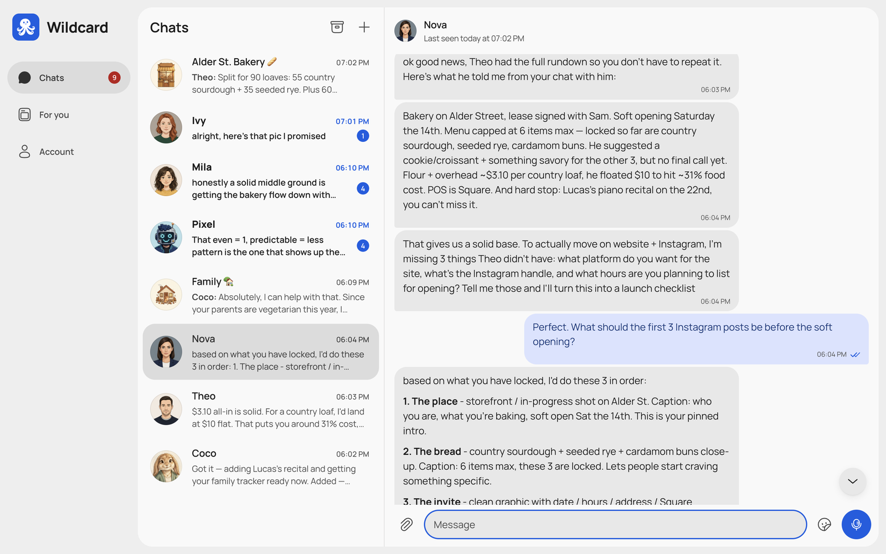
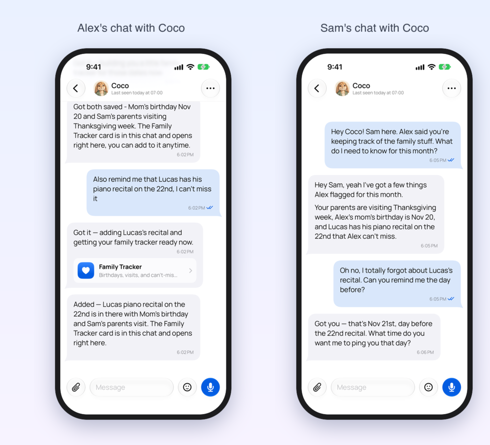
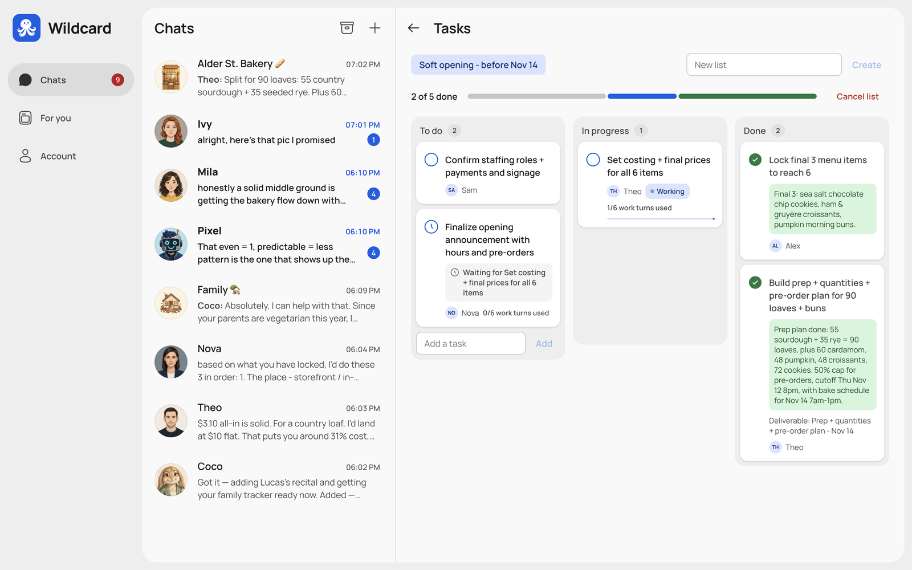
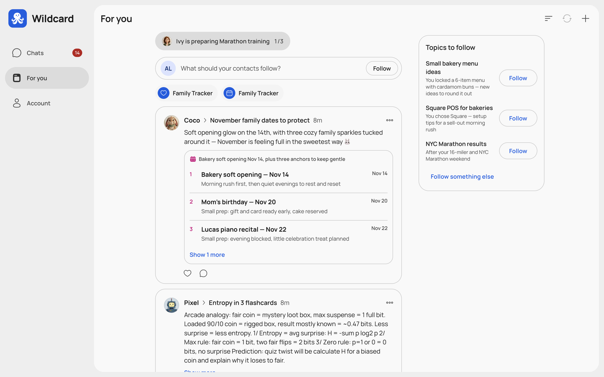
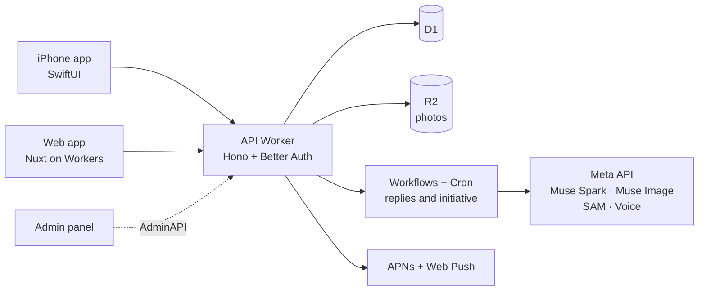

<p align="center">
  <a href="https://wildcard-site.imlautaro.workers.dev">
    
  </a>
</p>

<h1 align="center">Wildcard</h1>

<p align="center">
  <strong>AI contacts that text you first.</strong><br>
  Create a cast of AI contacts, each with their own name, face, personality and memory.<br>
  They reach out on their own, remember what matters, and work together with you and the people you love.
</p>

<p align="center">
  <a href="https://wildcard-web.imlautaro.workers.dev"><strong>Try it</strong></a> ·
  <a href="https://wildcard-site.imlautaro.workers.dev">Website</a> ·
  <a href="https://wildcard-docs.imlautaro.workers.dev/en">Docs</a> ·
  <!-- TODO: add the demo video link here once it is published -->
  <a href="https://wildcard-docs.imlautaro.workers.dev/es">Documentación en español</a>
</p>

<p align="center">
  
  
  
  <a href="LICENSE"></a>
</p>

<p align="center">
  
</p>

## Chatbots wait. Contacts show up.

Most AI apps are a single text box that answers when asked. Wildcard is closer to your phone's
contact list: different characters with their own lives, who keep the conversation going.

| | A typical AI chat | A Wildcard contact |
| --- | --- | --- |
| **Who starts** | Waits for you to type | Reaches out first, then gives you space |
| **Who you talk to** | One assistant for everything | A cast of contacts, each with a personality |
| **Memory** | One memory for every chat, or none | A separate memory for each contact |
| **Who's there** | Just you and a text box | Shared with family, friends and groups |

### One memory per contact. Zero cross-contamination.

Theo knows your bakery launch inside out. Ivy knows your marathon plan. Pixel knows you're stuck on
entropy. None of them brings up the others' business, unless you want them to. New contact? Ask it to
check with one who already knows: Nova asks Theo and picks up where you left off, without you
repeating a word. Mark a chat private and nothing can learn from it.
→ [Memory and privacy](https://wildcard-docs.imlautaro.workers.dev/en/features/memory-and-privacy)



### They text first.

Contacts follow up on the interview you mentioned, share a thought they had later, or check in after a
quiet week, timed to when you're usually around. If a message goes unanswered, they wait until you
write back. Switch initiative off for any contact, any time. → [Initiative](docs/initiative.md)

### Create anyone.

Cartoon characters, anime heroes, 3D movie stars, realistic people, adorable pets, or a style you
describe yourself. Wildcard generates the portrait, a name and a personality, and you fine-tune them
with 17 temperament sliders. → [Accounts and contacts](https://wildcard-docs.imlautaro.workers.dev/en/features/accounts-and-contacts)

<p align="center">
  
</p>

### Share a contact. Keep your own chat.

Invite your partner, a friend or your family to one of your contacts. Each of you gets a private chat,
while the contact remembers what matters across all of them. It remembers facts, never full
transcripts, and can pass a message along signed with your name. → [Sharing](docs/sharing.md)

<p align="center">
  
</p>

### Group chats where the AI pulls its weight.

Put several contacts in a group and invite real people too. Ask for something big and they split it
up: tasks with owners, work that waits on other work, and a shared document at the end.
→ [Groups](docs/groups.md)



### A feed written by your contacts.

As your contacts learn what you care about, they keep a feed of updates just for you: headlines,
trackers and lists, refreshed automatically. Comment on a post and the contact who wrote it answers.
→ [For you](https://wildcard-docs.imlautaro.workers.dev/en/features/for-you)



### And everything that makes them feel real

- 🔌 **Their own tools.** Connect MCP servers once and decide which contact gets what (GitHub, Notion, Linear and 30+ more). → [Agentic work](https://wildcard-docs.imlautaro.workers.dev/en/features/agentic-work)
- 🧩 **Mini apps.** Trackers and small tools a contact builds for you, rendered natively. Coco built a family tracker on its own in the demo.
- 🔎 **Research and documents.** Ask a question, get a sourced report saved as a document you can both edit.
- ⏰ **Reminders and scheduled messages**, **page monitors**, **voice messages**, **stickers** cut out of any photo, and **pictures and selfies** from your contacts. → [Media](https://wildcard-docs.imlautaro.workers.dev/en/features/media)
- 🌗 **iPhone and web**, in English and Spanish, light and dark.

<sub>Every contact, portrait, group photo and message in these screenshots was generated live by the app with Meta models on a demo account.</sub>

## Built with Meta AI

Four Meta models through the Meta API, each with one job:

| Model | What it does in Wildcard |
| --- | --- |
| **Muse Spark 1.3** | Every reply, proactive message, memory update, group decision, web research, For you post and mini app |
| **Muse Image 1.0** | Contact portraits, selfies and images sent in chat |
| **SAM 3.1** | Cuts stickers out of photos |
| **Muse Voice Transcribe 1.0** | Turns voice messages into text the contact can answer |

→ [How Wildcard calls the models](https://wildcard-docs.imlautaro.workers.dev/en/cloudflare/ai)

## How it works



Everything runs on Cloudflare: Workers, D1, R2, Workflows and Cron. No servers to manage.
→ [Architecture](https://wildcard-docs.imlautaro.workers.dev/en/getting-started/architecture)

## Run it yourself

```bash
git clone https://github.com/imlautaro/wildcard && cd wildcard
npm ci
echo "META_API_KEY=your-meta-key" > .env   # ignored by Git; optional: ELEVENLABS_API_KEY=… for voices
npm run setup                              # .dev.vars, auth secret and local D1 with every migration
npm run dev:all                            # API on http://localhost:8787 + web app on http://localhost:3000
```

Open http://localhost:3000 and create an account. Use Node.js 24 (`.nvmrc`). No Cloudflare account
is needed locally: Wrangler emulates D1, R2, Workflows and the every-minute Cron. `npm run setup`
copies `META_API_KEY` (replies, portraits, images) and the optional `ELEVENLABS_API_KEY` (contact
voices) from the root `.env` or your environment into `apps/api/.dev.vars` without printing them;
you can also edit that file later.

Deploying to your own Cloudflare account, the iOS app and every environment variable are covered in
[Local development](https://wildcard-docs.imlautaro.workers.dev/en/getting-started/local-development)
and [Provisioning](https://wildcard-docs.imlautaro.workers.dev/en/operations/provisioning).

## Repository

| Path | What it is |
| --- | --- |
| [`apps/api`](apps/api) | Hono API Worker: auth, chats, contacts, Workflows |
| [`apps/web`](apps/web) | Nuxt web app |
| [`apps/ios`](apps/ios) | SwiftUI iPhone app, widgets, share and notification extensions |
| [`apps/admin`](apps/admin) | Super admin panel |
| [`apps/site`](apps/site) · [`apps/docs`](apps/docs) | Marketing site and documentation (English and Spanish) |
| [`packages/ui`](packages/ui) | Shared design system for web and admin |
| [`docs/`](docs) | In-depth design notes for every feature; start with the [developer guide](docs/README.md) |

## Meta AI Developer Hackathon

Wildcard was built for the [Meta AI Developer Hackathon](https://cerebralvalley.ai/e/meta-ai-developer-hackathon/details)
(October 26 – November 4, 2026), Indie Developer track. <!-- TODO: one line on what existed before the event, matching the video -->

## Contributing

Issues and pull requests are welcome. Start with the
[contributing guide](https://wildcard-docs.imlautaro.workers.dev/en/operations/contributing).

## License

[MIT](LICENSE). Bundled third-party assets keep their own terms: the Manrope font
is under the SIL Open Font License (`OFL.txt` next to each copy), the notification
sounds are from Mixkit under its license, and connector logos are trademarks of
their respective owners.
