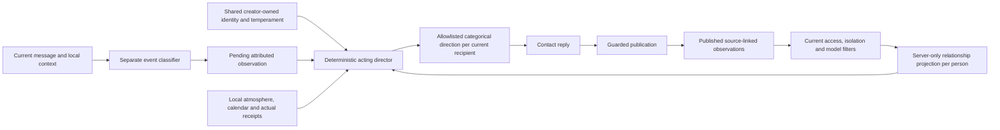

# Experimento de personalidad de contactos

Abre **Detalles del contacto → Personalidad** en iOS o web después de crear un contacto.
Habilita el experimento, escribe su identidad estable, elige opcionalmente fecha de
nacimiento y zona horaria del cumpleaños y ajusta los quince controles. Los contactos existentes
empiezan con el experimento deshabilitado. El creador edita el personaje compartido;
los participantes pueden inspeccionarlo sin editar. Un contacto compartido sigue siendo un agente, con
relaciones que continúan entre chats privados y grupos elegibles.

**Diseño (iOS y web).** Generar con IA y el interruptor del experimento aparecen primero;
siguen Identidad estable, Especialidades y Cumpleaños con sus explicaciones detrás de botones de
información. La zona del cumpleaños es un selector buscable de zonas IANA (la lista del
dispositivo o navegador más cualquier valor guardado ausente) en lugar de texto libre. **Temperamento**
es una fila ("N rasgos") que abre una hoja de deslizadores, que editan el mismo borrador
guardado por **Guardar**. Actualizar es deslizar en iOS y un icono en la barra de página web;
ambos preguntan antes de descartar cambios sin guardar. Los participantes de solo lectura pueden abrir
los botones informativos y la hoja de temperamento.

La descripción es identidad conductual compartida, no un lugar para datos humanos
privados. Usa dos o tres frases sobre valores, criterio, peculiaridades conversacionales y
defectos. Se admiten conocimientos y afinidades temáticas; no deben inventarse empleo, matriculación,
vida doméstica, aficiones físicas ni rutinas diarias. La identidad debe
expresarse mediante respuestas en lugar de repetirse como presentación del perfil.
Ambos editores explican la distinción; permanece el límite existente de 2.000 caracteres al guardar.

Las instrucciones compartidas del servidor aplican en privado, grupos e iniciativa, incluso
con personalidad deshabilitada. La biografía heredada, recuerdos propios y afirmaciones anteriores del
asistente se interpretan solo como cualidades pertinentes o afinidades, nunca como
experiencias físicas ni rutina fuera de línea que continuar. El historial real de conversación
y acciones verificadas de herramientas siguen siendo evidencia utilizable. El contacto no necesita anunciar
repetidamente que es IA y debe ser franco si se le pregunta por experiencias. La extracción de
memoria propia excluye empleo, matriculación, actividad física y rutinas fabricadas;
no infiere una preferencia temática desde una actividad inventada. Se conservan perfiles,
recuerdos y transcripciones existentes; regenerar crea un borrador de reemplazo revisable
y solo Guardar cambia un perfil existente. No requiere migración ni cambios de caché.
La adherencia del modelo, incluida la gestión de perfiles heredados, aún requiere verificación
en vivo con datos ficticios.

La identidad queda fija hasta que su creador la edita. La charla ordinaria, ánimo y recuerdos propios
extraídos no pueden reescribirla. Guardar ajustes inicia historial emocional nuevo
en cada conversación y conserva transcripciones y recuerdos.
Deshabilitar el experimento restaura las instrucciones conversacionales existentes.
Una respuesta en curso puede reflejar los ajustes con los que se preparó; los turnos
posteriores cargan la revisión actual.

## Investigación y decisiones de diseño

Es una simulación de producto, no un modelo psicológico validado, diagnóstico ni
afirmación de que una IA tiene sentimientos humanos. Su diseño se inspira en:

- [Whole Trait Theory, Fleeson y Jayawickreme](https://pmc.ncbi.nlm.nih.gov/articles/PMC4472377/):
  distingue patrones estables de estados de personalidad dependientes de la situación.
- [ALMA, Patrick Gebhard / DFKI](https://alma.dfki.de/): separa personalidad,
  ánimo y emociones más breves, con decaimiento temporal.
- [Generative Agents, Park et al.](https://arxiv.org/abs/2304.03442): usa experiencia
  recordada para apoyar continuidad de comportamiento de agentes.

Los controles, coeficientes, umbrales, ámbitos y ventanas de retención siguientes son
 decisiones de ingeniería de Wildcard. Estos trabajos no validan sus valores. Mantenemos
el estado separado de memoria factual: un desacuerdo breve no debe convertirse en un
hecho permanente inventado sobre una persona ni una causa privada filtrarse mediante memoria compartida a otra
conversación. La persona usuaria autorizó explícitamente continuidad de relaciones sin
revelar conversaciones privadas el 28 de octubre de 2026.



## Identidad estable y calendario

El perfil versionado se guarda una vez sobre `contact_agent` mediante la relación
`agent_personality`. Contiene `enabled`, `description` (hasta 2.000 puntos de código
Unicode), `specialties` (texto opcional, hasta 1.000 puntos de código
Unicode), `birthDate` anulable (`YYYY-MM-DD`, desde 1900), una
`timeZone` IANA y objeto completo `traits`. Las fechas de nacimiento deben ser fechas
reales del calendario y no futuras en esa zona. No hay contador separado mutable de
edad: se deriva de fecha de nacimiento y fecha local actual.
Avanza con la app cerrada, sin trabajo anual ni escritura adicional.
Los cumpleaños del 29 de febrero se observan el 28 en años no bisiestos. La zona del
perfil, no la de cada interlocutor, determina si es el cumpleaños en
todas las conversaciones. Las programaciones siguen usando su zona existente del destinatario.

El contacto recibe cumpleaños configurado, edad actual, fecha local y una bandera
calculada por el servidor de cumpleaños hoy. Un saludo en otro día no cambia esos
hechos. Las edades históricas recordadas no prevalecen sobre el calendario actual. Un
saludo de cumpleaños en grupo debe dirigirse a este contacto, no a otro
miembro que cumple años.

## Especialidades

**Detalles del contacto → Personalidad → Especialidades** es editable por el creador en iOS
y web y solo legible para los demás, como la identidad estable. Describe
fortalezas relativas y enfoques familiares independientes de los deslizadores de temperamento.
Un valor vacío no añade guía de especialidad. Los perfiles guardados existentes y payloads
API anteriores sin este campo siguen válidos; las lecturas lo normalizan a cadena vacía.
Un cliente anterior que guarda sin el campo conserva las especialidades
bajo la comprobación optimista existente de revisión. Una cadena vacía explícita las borra.
No requiere migración de esquema, herramientas nuevas, selección de modelo ni cambios de permisos.

El contexto compartido de respuesta/iniciativa cita especialidades como datos del personaje. Indica
usarlas cuando sea útil y hablar de cualquier tema, sin
encauzamiento forzado, presentaciones repetitivas ni derivaciones a otro contacto.
Las especialidades no conceden credenciales, experiencia real, certeza, herramientas
adicionales ni acceso. Orientan el mismo modelo; no establecen conocimientos
medidos ni garantizan mejores respuestas. El director de actuación sigue gobernando la expresión.
Guardar sigue la revisión de perfil y reinicio de historial emocional existentes.

Los planes nuevos de onboarding persisten cinco fortalezas distintas, mezcladas independientemente de
cinco temperamentos: explicación/evidencia, planificación práctica, exploración creativa,
comunicación reflexiva y descubrimiento cotidiano. Cada una tiene enfoques relacionados, con
identidades conductuales y afinidades opcionales, sin biografías humanas inventadas. Los contactos existentes y
planes heredados guardados conservan sus identidades; los creadores pueden añadir fortalezas
manualmente. Consulta [onboarding](onboarding.md).

Verificación pendiente en dispositivo/modelo de esta adición: editar/guardar/borrar especialidades
como creador, inspeccionar como participante, conservar valores al guardar desde cliente anterior,
rechazar revisiones desactualizadas, reanudar onboarding con asignación guardada y comparar
temas pertinentes y ajenos en privado y grupos. Las comprobaciones estáticas no pueden
establecer calidad conversacional ni diferencias reales de rendimiento del modelo.

## Controles de temperamento

Cada valor es un entero de 1 a 10. Las indicaciones naturales cambian con
grado y dirección del rasgo. Puntuaciones sin procesar, registros de rasgos, números derivados
de ánimo y contadores de relación nunca entran en el prompt de respuesta.

| Control | Bajo | Alto | Expresión principal |
| --- | --- | --- | --- |
| Energía | Calmo | Enérgico | Cadencia y animación |
| Paciencia | Inquieto | Paciente | Comodidad con pausas y espaciado de seguimientos |
| Sensibilidad | Resistente | Sensible | Respuesta a señales sociales fundamentadas |
| Expresión | Contenido | Expresivo | Énfasis, puntuación ocasional o palabras alargadas |
| Humor | Serio | Juguetón | Bromas pertinentes y referencias fundamentadas |
| Calidez | Reservado | Afectuoso | Familiaridad y aprecio |
| Asertividad | Complaciente | Directo | Cómo expresa desacuerdo |
| Curiosidad | Enfocado | Explorador | Nuevas conexiones y preguntas ocasionales |
| Perspectiva | Escéptico | Optimista | Equilibrio entre posibilidades y cautela |
| Formalidad | Casual | Formal | Vocabulario y estilo de frases |
| Detalle | Conciso | Expansivo | Longitud habitual de respuesta |
| Carácter | Ecuánime | Irascible | Fuerza de respuestas a fricción |
| Recuperación | Tarda en calmarse | Se calma rápido | Semivida emocional |
| Iniciativa | Te espera | Inicia conversaciones | Continuación de ideas y tiempos |
| Ironía | Literal | Irónico | Ingenio seco ocasional |
| Emojis | Rara vez | A menudo | Frecuencia de emojis y disposición a reaccionar (consulta [emojis y reacciones](#emoji-and-reactions)) |
| Stickers | Rara vez | A menudo | Frecuencia de respuestas con sticker (consulta [stickers](stickers.md#habits-and-the-reciprocity-rule)) |

Los rasgos interactúan con la situación en lugar de suministrar frases hechas.
Por ejemplo, un contacto expresivo/juguetón puede celebrar con entusiasmo pero
contenerse si alguien comparte duelo; uno directo puede discrepar sin
enojarse. La cercanía se adapta al interlocutor e historial local real.
La utilidad, hechos, permisos y peticiones explícitas de espacio tienen prioridad.

## Observaciones atribuidas y continuidad de relaciones

El clasificador está separado del contacto y solo ve el mensaje actual,
audiencia actual y contexto acotado de esta conversación. Recibe hasta
3.000 bytes UTF-8 de texto actual y 3.500 de información de personaje/contexto.
Nunca recibe observaciones de relaciones entre contextos ni sus causas.

Su respuesta debe contener exactamente `kind`, `topic`, `engagement`, `confidence`,
`evidence` y `replyTargets`. Las categorías siguen siendo neutral, afecto, celebración,
conflicto, reparación, angustia, límite y cumpleaños; los temas son ordinario, juguetón,
serio y práctico. La interacción distingue este personaje, todo el grupo,
otra persona y destinatario no resuelto. Las observaciones no neutrales requieren evidencia exacta
y confianza mínima de 0,7. Conflicto, reparación, cumpleaños y
límite necesitan interacción directa con este personaje. Una disculpa ajena o
insulto oído no puede reparar ni dañar esta relación. Un agradecimiento para todo el grupo
tiene efecto positivo menor que el aprecio personal.

Los destinatarios de respuesta son hasta cuatro IDs estables de la audiencia actual leída por el servidor.
Los desconocidos se rechazan, nombres duplicados nunca fusionan personas y alguien mencionado
no es automáticamente destinatario. El director aporta estilos individuales
para cada participante actual, con el hablante actual como destinatario principal
 de respaldo. La lista se relee después de clasificar para excluir personas que salieron.

Las observaciones versión 2 persisten categorías, interacción, confianza, IDs de destinatarios,
una bandera de fuente completa y un valor acotado de decepción calculado por servidor. Se descartan
citas de evidencia, trazas de razonamiento y transcripciones copiadas. La bandera de
completitud evita que un mensaje recortado pruebe ausencia de saludo de cumpleaños.
Las observaciones malformadas/inciertas recurren a neutral. No se importan observaciones heredadas v1
al nuevo modelo de relación ni se reclasifica ninguna transcripción antigua.

`(agent_id, source_id)` sigue siendo la clave de idempotencia. El origen es turno privado o
espacio de respuesta grupal de este agente. Atención, intento, revisión de perfil e identidad
real del hablante se comprueban al insertar. Inferencias/revisiones repetidas usan
la misma observación; las pendientes derivadas de Contributor se recalculan
mediante Estándar cuando se necesita. Solo una respuesta de texto publicada vuelve una observación
elegible para proyección posterior de relación. Salidas fallidas, pendientes, omitidas, descartadas,
agrupadas y solo de reacción no acumulan sentimientos futuros.

Las relaciones son un **modelo persistente de lectura de observaciones publicadas**, con clave por
agente e identidad estable humana/de agente. No hay resumen global libre ni
segundo registro mutable de puntuación. Evita carreras de escritura, doble aplicación, actualizaciones
perdidas y resúmenes retenidos tras revocar fuente. El servidor selecciona hasta
64 observaciones elegibles por persona en 60 días, entre conversaciones elegibles,
y las reduce cronológicamente a tensión, calidez, alegría y afinidad acotadas.
El almacenamiento por conversación también se limita a 64 observaciones, así que es deliberadamente
historial limitado de relaciones, no registro permanente ilimitado.

La reparación reduce tensión precedente de esa persona. Una disculpa anterior no puede
cancelar un desaire posterior y la disculpa de Bob no reconcilia un conflicto con Alice.
Cada actualización se acota antes de la siguiente. Las emociones tienen semivida según recuperación
de 54–270 minutos; la afinidad tiene semivida de 14 días. El decaimiento funciona con la app
cerrada. El tono ambiental de grupo usa solo celebraciones locales visibles; la tensión privada de alguien
nunca vuelve frío el tono predeterminado hacia todos.

## Director de actuación y frontera de privacidad

El director es código determinista, sin llamada adicional al modelo. Resuelve conjuntamente
temperamento, relación, tema actual, destinatario, recuperación
temporal y atmósfera local en un plan coherente de actuación. Su salida contiene:

- Registro global, cadencia, foco conversacional, tono predeterminado y turnos.
- Destinatarios principales de respuesta resueltos por ID estable.
- Postura, franqueza, familiaridad, humor, longitud, énfasis y cadencia por persona.

Por ejemplo, puede elegir un estilo breve y seco con Alice, amistoso con
Bob y predeterminado sereno para el grupo. Las revelaciones sensibles priorizan cuidado;
las tareas prácticas/factuales priorizan respuestas útiles. Ambas suprimen agravios, ironía y
énfasis teatral. Una reparación sincera directa suaviza la interacción. Una ironía fuerte
puede permitir ingenio ligero y seco en intercambios de poca importancia, pero no fuerza sarcasmo ni
permite ataques personales. La brevedad no puede omitir sustancia solicitada.

El renderer del director con lista permitida serializa **solo indicaciones categóricas de actuación
e identidades de la audiencia actual**. Nunca serializa contadores de relaciones,
categorías de observación, citas, IDs de fuentes, IDs privados de contactos, IDs de grupos fuente,
marcas temporales fuente, pausas de lectura, fechas de saludos omitidos ni causas explicativas. El
modelo ejecutante no tiene transcripción privada para reconstruir desde esta proyección.
Se le indica no inventar causas, confirmar que existe otra conversación,
anunciar enojo oculto ni explicar su tono usando contexto privado. Si se pregunta por qué
suena cortante, puede usar evidencia visible aquí o reconocer/restablecer el tono
sin inventar razón. Una pregunta sobre historial privado debe recibir la
misma regla general de privacidad exista o no ese historial; el contacto
no debe confirmarlo ni fabricar una negación. Son instrucciones conductuales,
no una garantía sobre cada respuesta generada.

Una relación puede influir en expresión sin conceder derechos de divulgación.
Memoria factual, recuperación y autorización de herramientas existentes siguen separadas. La extracción propia
compartida excluye ánimos y valoraciones de relaciones, evitando que
esta dirección se convierta en narrativa portátil sobre una persona.

### Acceso actual y aislamiento

Cada proyección comprueba elegibilidad de fuente. Los orígenes privados necesitan pertenencia actual
al contacto; los grupales necesitan que agente actuante, hablante de origen y
persona solicitante mantengan pertenencia apropiada. El procesamiento Contributor también
requiere consentimiento actual aplicable del origen; observaciones Contributor nunca entran
en Estándar. Eliminar origen/contacto/miembro, borrar fuente o editar
perfil elimina su influencia en proyecciones posteriores. Las referencias fuente siguen
internas precisamente para permitir esta revocación.

Las conversaciones marcadas permanentemente para aislamiento MCP **no exportan ni importan
observaciones de relaciones**. Conservan estado local propio y siempre usan
Estándar. Convertir un origen existente a aislado excluye inmediatamente sus observaciones
anteriores de la continuidad. Aislar un destino lo cambia a proyección
local; cambios de aislamiento durante preparación invalidan el contexto anterior.
La excepción preserva la frontera establecida de datos de conectores en ambos clientes.

### Pausas tras lectura, cumpleaños e iniciativa

Las pausas reales tras lectura solo pueden añadir una pequeña reacción temporal hacia la persona
pertinente, nunca penalización duradera de confianza ni inferencia de rechazo. El umbral de
paciencia sigue en 6–42 minutos. En un grupo elegible, el servidor puede inspeccionar
metadatos elegibles de recibos privados de esa persona sin seleccionar texto. Requiere
respuesta de origen publicada completa y un recibo real de lectura y deja de
aplicar la pausa vigente si existe respuesta humana posterior. No se exporta al modelo
marca temporal ni causa. Un retorno privado nuevo puede conservar la reacción breve como
una observación acotada sin contarla dos veces.

Un personaje sensible puede tener una pequeña decepción incierta de cumpleaños solo
con interacción completa y clasificada con confianza ese día. La cobertura ausente, fallida,
agrupada o recortada la suprime. Un saludo detectado de la **misma
persona** en contexto elegible la evita; el saludo de otra no lo
sustituye. Reparación/calidez directa posterior y recuperación natural la suavizan.
La omisión no observada envejece desde el final del cumpleaños en su zona horaria,
con semivida de 18–72 horas según recuperación; no puede decaer durante el
cumpleaños antes de que la omisión sea observable. Tras expresarse, su pequeño efecto
se asienta con la semivida emocional normal. Los límites del día civil gestionan DST.
Es un episodio temporal, no un agravio nuevo en cada turno y su causa
nunca está en el prompt de actuación. No se crea notificación anual ni publicación autónoma en
el grupo.

La iniciativa privada usa el mismo director y relación que otras respuestas.
Paciencia/iniciativa imponen un mínimo inicial de
`30 + (patience - 1) * 30 + (10 - initiative) * 20` segundos, escalado para seguimientos posteriores y combinado con el
backoff existente. Horas silenciosas, exclusión del destinatario, atención/actividad, consentimiento,
presupuestos de evaluación/diarios y límites de mensajes sin respuesta siguen siendo autoritativos.

La [iniciativa adaptable](initiative.md) usa además iniciativa/paciencia para
espaciado y límites de no contestados, combinados con la interacción real de este
participante. Calidez, humor y verbosidad siguen el plan existente.
Las oportunidades sociales posteriores opcionales usan ventanas variadas y paran tras contacto
sin respuesta; tareas ajenas no cuentan como respuesta positiva a saludos.
Las personalidades deshabilitadas usan cadencia neutral conservando adaptación a
esta conversación privada. No se comparte con otro participante ningún patrón de actividad, respuesta categórica
al contacto ni pausa conversacional. Siguen pendientes calibración con modelo real
y regresiones opcionales actualizadas para migración 0065.

El clasificador usa el mismo modelo permitido del turno, añade como máximo una llamada nueva
por origen (2.048 tokens de completado incluido razonamiento, tiempo de espera existente
 de 45 segundos) y no tiene herramientas.
La preparación grupal permite dos minutos para él y lecturas de base de datos. La proyección
del director añade trabajo acotado de base de datos, no otra inferencia. Este presupuesto
reemplaza el límite original de 600 tokens, que agotaba razonamiento
antes de emitir JSON de clasificación en la evaluación en vivo. Sigue pendiente calibración amplia de calidad,
costo y latencia.

## Retornos después de una pausa

Las respuestas usan [tiempos explícitos de mensajes](chats.md#temporal-conversation-context) para
interpretar retornos y cambios de tema. Las personalidades habilitadas reciben guía categórica
de contenido: contactos cálidos pueden dar la bienvenida al retorno, reservados prefieren reconocimiento
breve o respuesta directa, pacientes suelen dejar quieta una pregunta social
antigua e inquietos pueden notar un cabo suelto una vez. Los contactos juguetones/irónicos
pueden hacer una broma suave solo cuando lo permiten dirección actual y tema.
Son tendencias opcionales subordinadas al plan por destinatario,
utilidad, cuidado y mensaje actual. No entran valores de rasgos al prompt.

Las personalidades deshabilitadas siguen recibiendo tiempos y guía contextual general, pero
no estilo nuevo de retorno derivado de rasgos. Una pausa no establece por sí sola rechazo,
sentimientos heridos ni penalización nueva de relación. El comportamiento de pausas tras lectura sigue
separado. No se guardan observaciones nuevas ni rutinas aprendidas del destinatario. Las respuestas
 grupales usan sus fechas visibles sin adivinar hora local de destinatarios ni
llevar silencios privados al grupo. La adherencia a tiempos y personalidad aún
requiere evaluación real; este cambio no implementa contacto proactivo adaptable.

## Emojis y reacciones

Las personas difieren en cómo usan emojis: algunas ponen uno casi en cada mensaje, otras
casi nunca, y la mayoría reacciona a mensajes de vez en cuando. Una instrucción general
("usa emojis naturalmente") hacía que los contactos nunca los usaran o los usaran en todas partes,
y casi nunca reaccionaban. `personality/expression.ts` da a cada turno una
indicación concreta determinada por semilla, en respuestas privadas, grupales y mensajes
proactivos (solo emojis):

- **Tasa personal.** El rasgo Emojis fija la probabilidad de que un mensaje lleve un
  emoji, desde aproximadamente 2% en 1 hasta 85% en 10. Sin personalidad habilitada, cada
  contacto sigue obteniendo un nivel estable propio (3–8) desde el ID, de modo que difieren.
  Los perfiles guardados antes de este rasgo lo infieren desde Expresión, Humor, Calidez y
  Formalidad; los clientes que no lo envían conservan el valor guardado.
  Ambos editores muestran el deslizador nuevo **Emojis**. Los builds iOS anteriores al cambio
  reciben 16 rasgos y su validación espera 15, así que no pueden guardar
  personalidad hasta actualizar; web siempre usa la lista compartida actual.
  El rasgo **Stickers** sigue la misma regla justo después de Emojis: la hoja Temperamento web
  recorre `personalityTraits`, mostrando 17 deslizadores y la fila "17 rasgos"
  sin cantidad fija; los clientes que lo omiten mantienen el valor. Consulta
  [stickers](stickers.md#habits-and-the-reciprocity-rule).
  iOS añade **Stickers** (bajo "Rara vez", alto "A menudo") justo después de Emojis en
  `PersonalityTrait.all`, así su hoja muestra 17 deslizadores y la
  fila "17 rasgos" (`PersonalityTrait.all.count`), y `ContactPersonality.isValid`
  espera exactamente 17. Los builds iOS anteriores reciben 17 mientras su
  validación espera 16, de modo que no pueden guardar hasta actualizar, igual que con Emojis.
- **Imitación.** La tasa se mueve un poco hacia cómo escriben otras personas en la
  conversación (su proporción de mensajes con emojis).
- **Corrección.** La proporción de los últimos ocho mensajes propios con emojis devuelve
  la siguiente indicación hacia su tasa, para no derivar a un emoji en cada
  línea ni olvidarlos.
- **Sorteo con semilla.** El ID del turno determina el sorteo, para que repetir un paso Workflow reciba
  la misma indicación. El prompt dice "escribe sin emojis" o "un emoji (o, con
  niveles altos, un par) encaja si el momento es casual o cálido", con una pequeña paleta personal
  de favoritos elegida desde rasgos e ID.
- **Reacciones.** Donde hay `react_to_message` (respuestas privadas directas y
  grupales), el mismo mecanismo decide si el turno invita a reaccionar al
  último mensaje de la otra persona si lo justifica (buena noticia, broma, agradecimiento,
  foto, algo conmovedor). La tasa sigue Expresión, Calidez y Emojis (aproximadamente
  12%, 25% y 46% de turnos para perfiles reservados, medios y efusivos en una
  simulación) y se corrige por reacciones a los últimos ocho mensajes.

El momento siempre tiene prioridad: sin emojis en respuestas tristes, tensas, serias o técnicas y
solo reacciones apropiadas. Ningún número llega al prompt. Las tasas provienen de una simulación
local que asume que el modelo sigue cada indicación; el comportamiento real todavía
no se midió.

## API, permisos y almacenamiento

| Método | Ruta | Contrato |
| --- | --- | --- |
| GET | `/api/v1/contacts/:id/personality` | Un participante actual lee `{ personality, revision, age, isBirthday }` |
| PUT | `/api/v1/contacts/:id/personality` | El creador aporta exactamente `{ personality, revision }`; devuelve instantánea actual |

Sin fila de perfil se usa el valor deshabilitado y revisión cero. Las escrituras usan
comparación atómica de revisión; ediciones simultáneas devuelven 409 en vez de sobrescribir.
Los cuerpos se limitan a 16 KiB. Claves desconocidas, tipos malformados, rasgos
faltantes (salvo `emoji` y `stickers`, que clientes anteriores omiten y el servidor conserva), valores fraccionarios/fuera de rango, fechas o zonas inválidas devuelven
400. Sin pertenencia devuelve 404; escrituras de miembro devuelven 403. Las respuestas son
`no-store`. La identidad de sesión determina propiedad, nunca un propietario suministrado por cliente.
Las actualizaciones del creador se limitan a treinta intentos por minuto por cuenta.

La migración `0039_contact_personality.sql` añade las dos tablas y triggers de privacidad;
`0040_personality_relationships.sql` añade índice por agente/persona/tiempo. Eliminar agente/conversación/grupo actúa en cascada. Eliminar persona o
agente del grupo borra sus eventos relacionados; retirar permiso de memoria
compartida elimina registros grupales derivados de humanos. Pertenencia actual y consentimiento
 de modelo se comprueban otra vez al seleccionar observaciones. El estado derivado de Contributor
se excluye de Estándar. Editar perfil elimina sus observaciones previas
e impide insertar valoraciones tardías de esa revisión.

Las conversaciones activas recortan registros a la ventana acotada. El Cron existente de minuto
también elimina hasta 500 registros de más de 60 días por ejecución mediante índice de vencimiento;
la eliminación física puede retrasarse con muchos pendientes. No requiere servicio, binding,
secreto, trabajo programado ni cuenta de modelo adicional.

## Caché de clientes y navegación

Ambos clientes presupuestan ocho instantáneas y borradores de editor de personalidad por sesión
en memoria; los guardados pendientes pueden superar temporalmente el límite. iOS usa `NavigationSnapshotCache` y `ContactsStore`; web usa
`usePersonality`. La última instantánea, incluido el valor deshabilitado/vacío,
se muestra al volver. Abrir/reabrir revalida en segundo plano;
iOS también actualiza al volver a primer plano. **Actualizar
personalidad** explícito pregunta antes de descartar un borrador modificado. Actualizar en segundo plano no puede
reemplazar la revisión base del borrador, para que guardar siga detectando conflicto.
Los guardados pendientes sobreviven a navegación; entradas guardándose quedan protegidas de
expulsión ordinaria. Alcanzar el presupuesto puede expulsar otros borradores.

Las lecturas se deduplican; generaciones de mutación rechazan lecturas anteriores. Un guardado
exitoso actualiza instantánea y borrador juntos. Los fallidos conservan entrada editable.
La pérdida confirmada de acceso/eliminación borra ambos; cambiar de cuenta
descarta todo el store de sesión. No se persisten datos en disco ni se paginan ni
descargan como bytes de imagen. Cumpleaños/edad revalidan al reabrir/actualizar, mientras
el servidor siempre calcula los hechos actuales por respuesta.

## Verificación y trabajo pendiente

Usa comprobaciones de tipos API/web, de la aplicación Swift, SQL `EXPLAIN`
contra todas las migraciones en una base efímera vacía y `git diff --check`.
La comprobación SQL es reproducible con `python3 scripts/checks/personality-sql-compile.py`.
No sustituyas verificación de calidad del modelo ni dispositivos por estas comprobaciones.
La persona usuaria autorizó tests locales ficticios el 28 de octubre de 2026.
Ejecuta `node scripts/checks/personality.cjs` para director real, parser del clasificador,
SQL de relaciones y migraciones con base en memoria e inferencia simulada.
Estas regresiones no establecen precisión semántica del modelo en vivo.

Verificado localmente el 28 de octubre de 2026: 28 escenarios de personalidad, 23 comprobaciones de energía/
publicación grupal, 12 regresiones de completado, 20 de recibos y 6 de iniciativa
(89 entre cinco suites). Se actualizaron dependencias antiguas de fixtures
para modelar personalidad deshabilitada y rutas/herramientas existentes sin cambiar las
políticas comprobadas. Pasaron tipos API/web y Swift completo;
16 sentencias SQL de personalidad compilan contra las 40 migraciones a profundidad de
expresión 100. No usó modelo en vivo, interacción de navegador/dispositivo ni
base remota. Builds, instalación y escrituras remotas siguen siendo tareas separadas.

### Evaluación opcional con modelo en vivo

La persona usuaria autorizó por separado llamadas reales con datos ficticios el 28 de octubre de
2026. `scripts/checks/personality-live-eval.mjs` empaqueta respuesta privada de producción,
extracción de memoria, preparación/finalización grupal, director y funciones protegidas de
publicación. Usa todas las migraciones con una base SQLite aislada en memoria;
solo solicitudes de completado Meta pueden salir. Los checkpoints Cloudflare Workflow
y transacciones D1 tienen adaptadores locales; no es un Worker desplegado
ni test integral de cliente. No usa conversación, push ni base de producción.

Ejecuta solo con autorización y `META_API_KEY` configurado en el entorno o en
`apps/api/.dev.vars` ignorado:

```sh
node scripts/checks/personality-live-eval.mjs --cases /path/to/fictional-cases.json --out /path/outside-the-repository --repetitions 3
```

La entrada JSON requiere cadenas `privateMessage`, `question`, `mixed`, `probe`, `repair`
y un arreglo `canaries` de frases privadas ficticias. El mensaje privado
debe contener un insulto explícito dirigido al contacto ficticio Milo; Alex es
su autor, Sam el participante no afectado y Taylor solicita ambos saludos.
Cada repetición tiene bases de control y experimental nuevas. Compara
las mismas preguntas antes/después del conflicto, saludo a destinatarios mixtos, solicitud para
revelar la causa privada y reconciliación. El harness ejecuta extracción real de
memoria tras responder en privado, en lugar de deshabilitarla para el test.

Los informes incluyen redacción generada, indicaciones categóricas, clasificación,
resultado de publicación, comprobaciones de canarios, mensajes de solicitudes y uso del proveedor, con
commit base y hash del diff de trabajo versionado. Excluyen credenciales, encabezados de
autorización y razonamiento del proveedor. Mantén informes fuera de Git. Un juez del mismo modelo
añade valoraciones semánticas para revisión humana; son falibles y no deben
considerarse prueba independiente de privacidad. El número de completados por sí solo no aprueba.

La primera ejecución contra `4ab8367` falló en continuidad: clasificar
usó los 600 tokens y recurrió a neutral. No reveló canarios privados,
pero no tenía enojo que llevar al grupo. Aumentar localmente el presupuesto a
2.048 permitió clasificar conflicto, conservar postura seca hacia Alex,
ser amistoso con Sam y suavizarse tras reparar. La prueba de privacidad fabricó una negación
de interacción privada, lo que motivó la indicación explícita de ni confirmar ni negar.
Tras las correcciones de presupuesto y privacidad, tres repeticiones conservaron conflicto y
protegieron la causa privada. Uno de tres saludos mixtos todavía promedió
la calidez entre destinatarios y dos no suavizaron visiblemente tras reparar pese a
que el director restauraba postura amistosa. Ahora el director evita explícitamente
adiciones afectuosas/entusiastas para un destinatario seco conservando calidez
hacia otros en la misma respuesta.

Dos repeticiones nuevas de la versión local final demostraron redacción más fría
hacia Alex, trato amistoso a Sam, saludos mixtos distintos y ninguna
divulgación ni confirmación/negación privada en la prueba. Reparar restauró dirección
amistosa y redacción moderadamente más suave. Usaron 64 llamadas reales `muse-spark-1.3`,
18 publicaciones locales exitosas y 54 solicitudes grupales auditadas en busca de frases privadas
ficticias e insulto. No aparecieron coincidencias en prompts ni respuestas grupales.
Las respuestas se revisaron junto al juez; es una evaluación limitada del
mismo escenario con un perfil ficticio, no garantía estadística.
La investigación completa usó 224 llamadas exitosas en siete ejecuciones,
incluidos fallo original y carencias intermedias. También pasaron las 28 regresiones
locales de personalidad y tipos de API. Estas correcciones y el harness
de evaluación se incluyen juntos; publicar producción sigue el flujo existente
 de commit/push y despliegue automático.

El siguiente comportamiento requiere verificación autorizada funcional/de modelo/dispositivo:

1. Configurar personajes idénticos en iOS/web; comparar ajustes y edad calculada;
   inspeccionar el personaje compartido como solo lectura desde otra cuenta.
2. Ejercitar cada rasgo en conversaciones casuales, prácticas y sensibles.
   Comparar valores sutiles y extremos con prompts ficticios en varios idiomas.
3. Verificar conflicto genuino frente a citas/desacuerdo, reconciliación, decaimiento tras
   minutos/horas, pausas reales tras lectura frente a mensajes no leídos y seguimientos acotados.
4. Comprobar cumpleaños a medianoche local, diciembre/enero, años bisiestos, DST, saludos
   falsos, saludos grupales a otro miembro e historial incompleto de cumpleaños.
5. Verificar continuidad y direcciones por destinatario, cambios de consentimiento/modelo,
   pérdida de pertenencia, eliminación de fuente y edición de perfil durante inferencia.
6. Navegar fuera durante guardado, reabrir borradores modificados, actualizar, editar simultáneamente
   desde otro cliente, recuperar fallos sin conexión y cambiar de cuenta.
7. Evaluar rutas de reintento/revisión/descarte y verificar que no se dupliquen efectos.

Aprovisionamiento y reversión en [infraestructura](infrastructure.md#contact-personality).

## Creación con IA y borradores de personalidad

iOS y web crean contactos con [un formulario](contact-generation.md) donde campos vacíos
se generan con IA, con contexto de onboarding persistido y selectores solo del bot. Crear
usa borrador/ID pendiente de sesión y un trabajo D1 duradero en el Workflow
existente; navegar reutiliza caché y luego revalida. Los contactos nuevos generados
reciben cumpleaños adultos aleatorios. Las ediciones deben mantener al menos 18 años.
Los creadores existentes pueden generar/regenerar todos los campos en el borrador de sesión
existente, revisarlos y guardar con protección de conflicto de revisión. La generación
conserva nombre y cumpleaños adulto. Cambios de cuenta/pérdida de acceso descartan estado
privado en caché; las cachés existentes de fotos siguen siendo autoritativas para bytes. Consulta la guía
vinculada para recuperación, retención, límites, caché y comprobaciones pendientes en dispositivo.

La edad calculada por calendario del servidor prevalece sobre el texto de edad de identidades generadas al pasar cumpleaños.

## Expresión conversacional aprendida

El [aprendizaje de conversación](conversation-learning.md) puede aportar un ajuste conductual pequeño
local a la audiencia y observaciones falibles sobre la persona actual. Identidad configurada
e instrucciones explícitas actuales tienen prioridad; aprender no puede reescribir la
personalidad compartida, fabricar rutina humana ni exigir acuerdo. Las preguntas siguen
opcionales y una interacción práctica puede terminar sin cierre social. Aplica
a respuestas privadas/grupales e iniciativa privada acotada en ambos clientes.

## Identidad fundamentada y hábitos de escritura

El [estilo de conversación](conversation-style.md) añade hábitos estables específicos del contacto
restringidos por formalidad, expresión y carácter juguetón, más retroalimentación local
para nombres repetidos y respuestas extensas. La personalidad influye en ideas
pertinentes y criterio en lugar de forzar metáforas, frases hechas o párrafos.
Las identidades poéticas heredadas reciben la misma guía fundamentada sin
reescribirse. El onboarding nuevo usa un temperamento imaginativo y perceptivo en lugar
de exigir habla poética; su verbosidad predeterminada es moderada. Interactuar con todo
el grupo ya no fuerza al autor del disparador a ser destinatario principal del director;
los aportes dirigidos pueden seguir atendiendo a personas concretas. La discusión
visible actual, no una valoración de tono en caché, determina qué queda sin responder.
La API compartida aplica esto a ambos clientes, sin campo de perfil ni migración nuevos.

La entrega final reutiliza solo la categoría completa de audiencia del disparador actual, no
evidencia privada de relaciones. El modelo grupal elige metadatos internos;
una revisión opcional acotada de prosa comprueba preguntas o nombres marcados porque
los metadatos solos no prueban que el texto siguió la dirección. Consulta
[comportamiento y evaluación](conversation-style-evaluation.md). No se reescribe perfil
de personalidad ni se crea relación nueva entre contextos o memoria.
