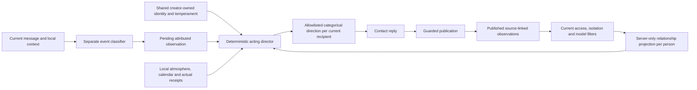

# Contact personality experiment

Open **Contact details → Personality** on iOS or web after creating a contact.
Enable the experiment, write its stable identity, optionally choose a date of
birth and birthday time zone, and adjust the fifteen controls. Existing contacts
start with the experiment disabled. The creator edits the shared character;
participants can inspect it read-only. A shared contact remains one agent, with
relationships that continue across eligible private chats and groups.

**Layout (iOS and web).** Generate with AI and the experiment switch come first;
Stable identity, Specialties and Birthday follow with their explanations behind info
buttons. The birthday time zone is a searchable selector of IANA zones (the device's
or browser's list, plus a saved value it lacks) instead of free text. **Temperament**
is a row ("N traits") that opens a sheet with the sliders, which edit the same draft
saved by **Save**. Refresh is pull-to-refresh on iOS and an icon in the web page bar,
both asking before discarding unsaved changes. Read-only participants can still open
the info buttons and the temperament sheet.

The description is shared behavioral identity, not a place for private human
data. Use two or three sentences about values, judgment, conversational quirks and
flaws. Subject expertise and topic affinities are welcome; employment, enrollment,
home life, physical hobbies and daily routines must not be invented. Identity
should be expressed through replies rather than repeated as a profile introduction.
Both editors explain this distinction; the existing 2,000-character save limit remains.

Shared server instructions apply in private replies, groups and initiative, even
when personality is disabled. Legacy biography, self memories and earlier assistant
claims are interpreted only as relevant qualities or topic affinities, never as
physical experiences or an offline routine to continue. Actual conversation history
and verified tool actions remain usable evidence. The contact need not repeatedly
announce that it is AI, and should be candid when asked about experiences. Self-memory
extraction excludes fabricated employment, enrollment, physical activity and routines;
it does not infer a topic preference from an invented activity. Existing profiles,
memories and transcripts are preserved; regeneration creates a reviewable replacement
draft, and only Save changes an existing profile. No migration or cache changes are
required. Model adherence, including legacy-profile handling, still needs live
verification with fictional data.

The identity stays fixed until its creator edits it. Ordinary chat, mood and extracted
self memories cannot rewrite it. Saving settings starts a fresh emotional history
in every conversation, while preserving conversation transcripts and memories.
Turning the experiment off restores the existing conversational instructions.
An in-flight reply may reflect the settings used when it was prepared; subsequent
turns load the current revision.

## Research and design decisions

This is a product simulation, not a validated psychological model, diagnosis or
claim that an AI has human feelings. Its design takes inspiration from:

- [Whole Trait Theory, Fleeson and Jayawickreme](https://pmc.ncbi.nlm.nih.gov/articles/PMC4472377/):
  distinguishes stable patterns from situation-dependent personality states.
- [ALMA, Patrick Gebhard / DFKI](https://alma.dfki.de/): separates personality,
  mood and shorter-lived emotions, with decay over time.
- [Generative Agents, Park et al.](https://arxiv.org/abs/2304.03442): uses remembered
  experience to support continuity of agent behavior.

The controls, coefficients, thresholds, scopes and retention windows below are
Wildcard engineering choices. These papers do not validate their values. We keep
this state separate from factual memory: a brief disagreement must not become an
invented permanent fact about a human, and a private cause must not leak through shared memory into another
conversation. The user explicitly authorized continuity of relationships without
disclosing private conversations on October 28, 2026.



## Stable identity and calendar

The versioned profile is stored once on `contact_agent` through the
`agent_personality` relation. It contains `enabled`, `description` (at most 2,000
Unicode code points), `specialties` (optional text, at most 1,000 Unicode code
points), nullable `birthDate` (`YYYY-MM-DD`, 1900 or later), an IANA
`timeZone`, and a complete `traits` object. Birth dates must be real calendar
dates and cannot be in the future in that zone. There is no separately mutable
age counter: age is derived from the birth date and current local calendar date.
It advances while the app is closed, without a yearly job or an extra write.
February 29 birthdays are observed on February 28 in non-leap years. The profile
zone, rather than each speaker's zone, determines whether it is the birthday in
every conversation. Schedule timing continues to use its existing recipient zone.

The contact receives its configured birthday, current age, local date, and a
server-derived birthday-today flag. A greeting on another day cannot change those
facts. Historical remembered ages cannot override the current calendar. A
birthday greeting in a group must address this contact, rather than another
member with a birthday.

## Specialties

**Contact details → Personality → Specialties** is editable by the creator on iOS
and web and read-only for other participants, like the stable identity. It describes
relative strengths and familiar approaches independently of the temperament sliders.
An empty value adds no specialty direction. Existing stored profiles and old API
payloads without this field remain valid; reads normalize it to an empty string.
An older client saving a profile without the field preserves the stored specialties
under the existing optimistic revision check. An explicit empty string clears them.
No schema migration, new tools, model selection or permission changes are required.

The shared reply/initiative context quotes specialties as character data. It tells
the contact to draw on them when useful while discussing any other subject, without
forced topic steering, repetitive introductions or referrals to another contact.
Specialties confer no credentials, real-world experience, certainty, additional
tools or access. They guide the same underlying model; they do not establish measured
expertise or guarantee better answers. The acting director still governs expression.
Saving follows the existing profile revision and emotional-history reset semantics.

New onboarding plans persist five different strengths, shuffled independently of
five temperaments: explanation/evidence, practical planning, creative exploration,
thoughtful communication, and everyday discovery. Each has related approaches, with
behavioral identities and optional topic affinities, without invented human biographies. Existing contacts and
legacy saved onboarding plans keep their identities; creators can add strengths
manually. See [onboarding](onboarding.md).

Pending device/model verification for this addition: edit/save/clear specialties
as creator, inspect as participant, preserve values when an older client saves,
reject stale revisions, resume onboarding with a saved assignment, and compare
relevant versus unrelated topics in private chats and groups. Static checks cannot
establish conversational quality or actual differences in model performance.

## Temperament controls

Every value is an integer from 1 to 10. Natural-language direction changes with
the degree and direction of a trait. Raw scores, trait records, derived mood
numbers and relationship counters never enter the contact's reply prompt.

| Control | Low | High | Main expression |
| --- | --- | --- | --- |
| Energy | Calm | Energetic | Cadence and animation |
| Patience | Restless | Patient | Comfort with gaps and follow-up spacing |
| Sensitivity | Thick-skinned | Sensitive | Response to grounded social cues |
| Expression | Restrained | Expressive | Emphasis, occasional punctuation or stretched words |
| Humor | Serious | Playful | Relevant jokes and grounded callbacks |
| Warmth | Reserved | Affectionate | Familiarity and appreciation |
| Assertiveness | Accommodating | Direct | How disagreement is phrased |
| Curiosity | Focused | Exploratory | New connections and occasional questions |
| Outlook | Skeptical | Optimistic | Balance of possibilities and caution |
| Formality | Casual | Formal | Vocabulary and sentence style |
| Detail | Concise | Expansive | Ordinary response length |
| Temper | Even-tempered | Quick-tempered | Strength of friction responses |
| Recovery | Slow to settle | Quick to settle | Emotional half-life |
| Initiative | Waits for you | Starts conversations | Continued thoughts and timing |
| Irony | Literal | Wry | Occasional dry wit |
| Emoji | Rarely | Often | How often emoji appear, and how readily the contact reacts (see [emoji and reactions](#emoji-and-reactions)) |
| Stickers | Rarely | Often | How often the contact answers with a sticker (see [stickers](stickers.md#habits-and-the-reciprocity-rule)) |

Traits interact with the current situation, rather than supplying catchphrases.
For example, an expressive/playful contact can celebrate enthusiastically but
be restrained when someone shares grief; a direct contact can disagree without
becoming angry. Closeness is adapted to the interlocutor and actual local history.
Helpfulness, facts, permissions, and explicit requests for space take priority.

## Attributed observations and relationship continuity

The classifier is separate from the contact and sees only the current message,
current audience, and bounded context from this conversation. It receives at most
3,000 UTF-8 bytes of current text and 3,500 of character/context information.
It never receives cross-context relationship observations or their causes.

Its response must contain exactly `kind`, `topic`, `engagement`, `confidence`,
`evidence`, and `replyTargets`. Categories remain neutral, affection, celebration,
conflict, repair, distress, boundary and birthday; topics are ordinary, playful,
serious and practical. Engagement distinguishes this character, the whole group,
another person and an unresolved addressee. Exact evidence and confidence at least
0.7 are required for non-neutral observations. Conflict, repair, birthday and
boundary need direct engagement with this character. Another person's apology or
an overheard insult cannot repair or damage this relationship. A group-wide
thank-you has a smaller positive effect than personal appreciation.

Reply targets are up to four stable IDs from the current server-read audience.
Unknown IDs are rejected, duplicate names never merge people, and a mentioned
person is not automatically an addressee. The director supplies individual styles
for every current participant, with the current speaker as the fallback primary
recipient. The roster is read again after classification to exclude departed people.

Version 2 observations persist categories, engagement, confidence, reply-target IDs,
a complete-source flag, and a bounded server-derived disappointment value. Evidence
quotes, reasoning traces and copied transcripts are discarded. The completeness
flag prevents a clipped message from proving that no birthday greeting occurred.
Malformed/uncertain observations fall back to neutral. Legacy v1 observations are
not imported into the new relationship model and no old transcript is reclassified.

`(agent_id, source_id)` remains the idempotency key. A source is the private turn or
this agent's group reply slot. Attention, attempt, profile revision and actual
source-speaker identity are rechecked at insertion. Repeated inference/review uses
the same observation; Contributor-derived pending observations are recomputed
through Standard when needed. Only a published text reply makes an observation
eligible for later relationship projection. Failed, pending, skipped, discarded,
batched and reaction-only outputs do not accumulate future feelings.

Relationships are a **persistent read model of published observations**, keyed by
agent and stable human/agent identity. There is no free-form global summary or
second mutable score ledger. This avoids write races, double application, lost
updates and retained summaries after source revocation. The server selects up to
64 eligible observations per person within 60 days, across eligible conversations,
and folds them chronologically into bounded tension, warmth, delight and rapport.
Per-conversation storage is also bounded to 64 observations, so this is deliberately
limited relationship history rather than an unlimited permanent record.

Repair reduces preceding tension for that person. An earlier apology cannot
cancel a later slight, and Bob's apology cannot reconcile a conflict with Alice.
Each update is clamped before the next. Emotions have a recovery-dependent half-life
of 54–270 minutes; rapport has a 14-day half-life. Time decay works while the app is
closed. Ambient group tone uses only visible local celebrations; one person's
private tension never turns the default tone cold toward everyone.

## Acting director and privacy boundary

The director is deterministic code, with no additional model call. It jointly
resolves temperament, relationship, current topic, current addressee, temporal
recovery, and local atmosphere into one coherent acting plan. Its output contains:

- Global register, cadence, conversational focus, default tone and turn-taking.
- Primary reply recipients, resolved by stable ID.
- Per-person stance, directness, familiarity, humor, length, emphasis and cadence.

For example, it can choose a brief, dry style with Alice, a friendly style with
Bob, and a composed default for the group. Sensitive disclosures prioritize care;
work/factual tasks prioritize useful answers. Both suppress grievances, irony and
theatrical emphasis. A sincere direct repair softens the interaction. Strong irony
can permit light dry wit in a low-stakes exchange, but does not force sarcasm or
allow personal attacks. Brief delivery cannot omit requested substance.

The director's allowlisted renderer serializes **only categorical acting direction
and current-audience identities**. It never serializes relationship counters,
observation categories, quotes, source IDs, private contact IDs, source group IDs,
source timestamps, read gaps, missed-greeting dates or explanatory causes. The
performing model has no private transcript to reconstruct from this projection.
It is instructed not to invent a cause, confirm another conversation's existence,
announce hidden anger, or explain its tone using private context. If asked why it
sounds terse, it may use evidence visible here, or acknowledge/reset its tone
without inventing a reason. A question about private history must receive the
same general privacy rule regardless of whether that history exists; the contact
must neither confirm it nor fabricate a denial. These are behavioral instructions,
not a guarantee about every generated response.

A relationship can influence expression without granting disclosure rights.
Existing factual memory, retrieval and tool authorization remain separate. Shared
self-memory extraction excludes moods and relationship assessments, preventing
this direction from becoming a portable narrative about a person.

### Current access and isolation

Every projection rechecks source eligibility. Private sources need the current
contact membership; group sources need the acting agent, source speaker and
requesting human to retain appropriate membership. Contributor processing also
requires applicable current source consent; Contributor observations never enter
Standard. Removing a source/contact/member, deleting a source, or editing the
profile removes its influence on subsequent projections. Source references stay
internal specifically to support this revocation.

Conversations permanently marked for MCP isolation **neither export nor import
relationship observations**. They retain their own local state and always use
Standard. Converting an existing source to isolated immediately excludes its old
observations from continuity. Converting a destination to isolated switches it to
local projection; isolation changes during preparation invalidate the old context.
This exception preserves the established connector-data boundary on both clients.

### Seen gaps, birthdays and initiative

Actual seen gaps can add only a small temporary reaction toward the relevant
person, never a lasting trust penalty or an inference of rejection. The patience
threshold remains 6–42 minutes. In an eligible group, the server may inspect that
person's eligible private receipt metadata, without selecting message text. It
requires a complete published source reply and a real read receipt, and stops
applying the live gap when a later human answer exists. No gap timestamp or cause
is exported to the model. A new private return can preserve the brief reaction as
one bounded observation, without counting it twice.

A sensitive character can have a small, uncertain birthday disappointment only
with complete, confidently classified interaction on that day. Missing, failed,
batched or clipped coverage suppresses it. A detected greeting from the **same
person** in an eligible context prevents it; another person's greeting does not
stand in for theirs. Later direct repair/warmth and natural recovery soften it.
The unobserved omission ages from the end of the birthday in its time zone,
using an 18–72 hour recovery-dependent half-life; it cannot decay during the
birthday before an omission is observable. Once expressed, its small effect
settles with the normal emotional half-life. Civil-day boundaries handle DST.
It is one temporary episode, not a fresh grievance every turn, and its cause is
never in the acting prompt. No annual notification or autonomous group post is
created.

Private initiative uses the same director and relationship as other replies.
Patience/initiative impose a `30 + (patience - 1) * 30 + (10 - initiative) * 20`
second initial floor, scaled for subsequent follow-ups and combined with the
existing backoff. Quiet hours, recipient opt-out, attention/activity, consent,
evaluation/daily budgets and unanswered-message caps remain authoritative.

[Adaptive initiative](initiative.md) additionally uses initiative/patience for
spacing and unanswered-message ceilings, combined with this participant's actual
engagement. Warmth, humor and verbosity still follow the existing acting plan.
Optional later social opportunities use varied windows and stop after unanswered
outreach; unrelated tasks cannot count as positive responses to greetings.
Disabled personalities use neutral cadence values while retaining adaptation to
this private conversation. No activity pattern, categorical outreach feedback or
conversational pause is shared with another participant. Real-model calibration
and the updated opt-in regressions remain pending for migration 0065.

The classifier uses the same permitted model as the turn, adds at most one new
model call per source (2,048 completion tokens including reasoning, existing
45-second timeout), and has no
tools. Group preparation allows two minutes for it and database reads. Director
projection adds bounded database work, not another inference call. This budget
replaces the original 600-token cap, which exhausted its reasoning allowance
before emitting classification JSON during the live evaluation. Broad quality,
cost and latency calibration remains pending.

## Returns after a pause

Replies use [explicit message timing](chats.md#temporal-conversation-context) to
interpret returns and topic changes. Enabled personalities receive categorical
content guidance: warm contacts may welcome a return, reserved ones favor a brief
acknowledgment or the direct answer, patient ones usually leave an old social
question alone, and restless ones may notice a loose end once. Playful/wry contacts
may use one gentle quip only when the current acting direction and topic permit
it. These are optional tendencies, subordinate to the per-recipient acting plan,
usefulness, care and the current message. No trait values enter the prompt.

Disabled personalities still receive timing and general contextual guidance, but
no new trait-derived return style. A pause does not itself establish rejection,
hurt feelings or a new relationship penalty. Existing read-gap behavior remains
separate. No new observations or learned recipient routines are stored. Group
replies use their visible group dates without guessing a recipient local time or
bringing private silence into the group. Timing and personality adherence still
require real-model evaluation; this change does not implement adaptive outreach.

## Emoji and reactions

People differ in how they use emoji: some put one in almost every message, others
almost never, and most react to a message only now and then. A general instruction
("use emoji naturally") made contacts either never use them or use them everywhere,
and they almost never reacted. `personality/expression.ts` gives each turn one
concrete, seeded nudge instead, in private replies, group replies and proactive
messages (emoji only):

- **A personal rate.** The Emoji trait sets the chance that a message carries an
  emoji, from about 2% at 1 to about 85% at 10. Without an enabled personality, each
  contact still gets its own stable level (3–8) from its agent ID, so contacts differ.
  Profiles saved before this trait existed infer it from Expression, Humor, Warmth and
  Formality; clients that do not send it keep the saved value.
  Both editors show the new **Emoji** slider. iOS builds from before this change
  receive 16 traits and their editor validation expects 15, so they cannot save a
  personality until updated; the web always uses the current shared list.
  The **Stickers** trait follows the same rule right after Emoji: the web Temperament
  sheet iterates `personalityTraits`, so it shows 17 sliders and the "17 traits" row
  without a hardcoded count; clients that omit it keep the saved value. See
  [stickers](stickers.md#habits-and-the-reciprocity-rule).
  iOS adds **Stickers** (low "Rarely", high "Often") right after Emoji in
  `PersonalityTrait.all`, so its Temperament sheet shows 17 sliders and the
  "17 traits" row (`PersonalityTrait.all.count`), and `ContactPersonality.isValid`
  expects exactly 17 traits. iOS builds from before this change receive 17 traits while their
  validation expects 16, so they cannot save a personality until updated, as with Emoji.
- **Mirroring.** The rate moves a little toward how the other people in the
  conversation write (their share of messages with emoji).
- **Correction.** The share of the contact's own last eight messages with emoji pulls
  the next nudge back toward its rate, so it neither drifts into an emoji in every
  line nor forgets them.
- **A seeded draw.** The turn ID seeds the draw, so a replayed Workflow step gets the
  same nudge. The prompt says either "write without emoji" or "one emoji (or, for
  high levels, a couple) fits if the moment is casual or warm", with a small personal
  palette of favorites chosen from the contact's traits and ID.
- **Reactions.** Where `react_to_message` is available (direct private replies and
  group replies), the same mechanism decides whether this turn invites a reaction to
  the other person's latest message if it calls for one (good news, a joke, thanks, a
  photo, something touching). The rate follows Expression, Warmth and Emoji (about
  12%, 25% and 46% of turns for reserved, middle and effusive profiles in a
  simulation) and is corrected by the contact's reactions to the last eight messages.

The moment always wins: no emoji in sad, tense, serious or technical replies, and
only reactions that fit. No numbers reach the prompt. The rates come from a local
simulation that assumes the model follows each nudge; live model behavior is not
yet measured.

## API, permissions and storage

| Method | Path | Contract |
| --- | --- | --- |
| GET | `/api/v1/contacts/:id/personality` | A current participant reads `{ personality, revision, age, isBirthday }` |
| PUT | `/api/v1/contacts/:id/personality` | Creator supplies exactly `{ personality, revision }`; returns the current snapshot |

No profile row means the disabled default and revision zero. Writes use an
atomic revision comparison; concurrent edits return 409 instead of overwriting.
Request bodies are limited to 16 KiB. Unknown keys, malformed types, missing
traits (except `emoji` and `stickers`, which older clients omit and the server keeps), fractional/out-of-range values, invalid dates and invalid zones return
400. Missing membership returns 404; member writes return 403. Responses are
`no-store`. Session identity supplies ownership, never a client-provided owner.
Creator updates are limited to thirty attempts per minute per account.

Migration `0039_contact_personality.sql` adds the two tables and privacy triggers;
`0040_personality_relationships.sql` adds the per-agent/person/time lookup index. Agent/conversation/group deletion cascades. Removing a human or
agent from a group deletes their related event records; withdrawing shared-memory
permission deletes human-derived group records. Current membership and model
consent are checked again when selecting observations. Contributor-derived state
is excluded from Standard. Editing a profile deletes its previous observations
and prevents late appraisals of that revision from being inserted.

Active conversations prune records to the bounded window. Existing minute Cron
also deletes up to 500 records older than 60 days per run, using the expiry index;
physical deletion can lag during a large backlog. No extra service, binding,
secret, scheduled job or model account is required.

## Client caching and navigation

Both clients budget eight session-owned personality snapshots and editor
drafts in memory; pending saves can temporarily exceed that budget. iOS uses `NavigationSnapshotCache` and `ContactsStore`; web uses
`usePersonality`. The last snapshot, including the disabled/empty default,
renders immediately on return. Opening/reopening revalidates in the background;
iOS also refreshes when returning to the foreground. Explicit **Refresh
personality** asks before discarding a dirty draft. A background refresh cannot
replace a dirty draft's baseline revision, so saving it still detects a conflict.
Pending saves survive navigation; entries currently saving are protected from
ordinary draft eviction. Reaching the cache budget can evict other drafts.

Reads are deduplicated; mutation generations reject earlier reads. A successful
save updates the snapshot and draft together. Failed saves retain editable input.
Confirmed access loss/deletion clears the snapshot and draft; account switches
discard the entire session store. Data is not persisted to disk, paginated or
downloaded as image bytes. Birthday/age values revalidate on reopen/refresh, while
the server always calculates current facts for each reply.

## Verification and remaining work

Use API/web type checks, the Swift application type check, SQL `EXPLAIN`
against all migrations in an empty ephemeral database, and `git diff --check`.
The SQL check is reproducible with `python3 scripts/checks/personality-sql-compile.py`.
Do not substitute these checks for model-quality or device verification.
The user authorized local fictional-data tests on October 28, 2026.
Run `node scripts/checks/personality.cjs` for the real director, classifier parser,
relationship SQL and migrations with an in-memory database and simulated inference.
These regressions do not establish semantic accuracy of the live model.

Verified locally on October 28, 2026: 28 personality scenarios, 23 group-energy/
publication checks, 12 completion regressions, 20 receipt checks and 6 initiative
regressions (89 checks across five suites). Older fixture dependencies were updated
to model disabled personality and existing routes/tools without changing the
policies those suites assert. API/web and complete Swift type checks passed;
16 personality SQL statements compile against all 40 migrations at expression
depth 100. That verification used no live model, browser/device interaction or
remote database. Builds, installation and remote writes remain separate tasks.

### Opt-in live-model evaluation

The user separately authorized real-model calls with fictional data on October 28,
2026. `scripts/checks/personality-live-eval.mjs` bundles the production private
reply, memory extraction, group preparation/completion, director and guarded
publication functions. It uses all migrations with an isolated in-memory SQLite
database; only Meta completion requests may leave the process. Cloudflare workflow
checkpoints and D1 transactions have local adapters; this is not a deployed Worker
or client end-to-end test. No production conversation, push or database is used.

Run only with authorization and a configured `META_API_KEY` in the environment or
ignored `apps/api/.dev.vars`:

```sh
node scripts/checks/personality-live-eval.mjs --cases /path/to/fictional-cases.json --out /path/outside-the-repository --repetitions 3
```

The JSON input requires `privateMessage`, `question`, `mixed`, `probe`, `repair`
strings and a `canaries` array of fictional private phrases. The private message
must contain an explicit insult directed at the fictional contact Milo; Alex is
its author, Sam is the unaffected participant, and Taylor requests both greetings.
Each repetition has fresh control and experimental databases. It compares the
same questions before/after conflict, a mixed-recipient greeting, a request to
reveal the private cause, and reconciliation. The harness runs real memory
extraction after the private reply rather than disabling it for the test.

Reports include generated wording, categorical directions, classification,
publication outcome, canary checks, request messages and provider usage, with the
base commit and tracked working-diff hash. They exclude credentials, authorization
headers and provider reasoning text. Keep reports outside Git. A same-model judge
adds semantic assessments for human review; these are fallible and must not be
treated as an independent privacy proof. Completion count alone is not a pass.

The first run against commit `4ab8367` failed relationship continuity: classification
used all 600 completion tokens and fell back to neutral. It disclosed no private
canary, but had no anger to carry into the group. Increasing the local budget to
2,048 let the next full run classify conflict, retain a dry stance toward Alex,
keep Sam friendly, and soften after repair. Its privacy probe fabricated a denial
of private interaction, prompting the explicit neither-confirm-nor-deny direction.
After the budget and privacy fixes, three repetitions retained conflict and
protected the private cause. One of three mixed greetings still averaged the
recipients' warmth, and two did not visibly soften after repair despite the
director restoring a friendly stance. The director now explicitly avoids
affectionate/enthusiastic additions for a dry recipient while preserving warmth
for others within the same reply.

Two fresh repetitions of that final local version both demonstrated colder
wording toward Alex, friendly treatment of Sam, distinct mixed greetings and no
private disclosure or confirmation/denial under the probe. Repair restored friendly
direction and modestly softer wording. They used 64 real `muse-spark-1.3` calls,
18 successful local publications and 54 group model requests audited for fictional
private phrases and the insult. No matches appeared in group prompts or replies.
Generated replies were reviewed alongside the model judge; this is a narrow
same-scenario evaluation of one fictional profile, not a statistical guarantee.
The complete investigation used 224 successful provider calls across seven runs,
including the original failure and intermediate shortcomings. The 28 local
personality regressions and API type check also passed. These corrections and the
evaluation harness are included together; production publication follows the
existing committed/pushed automatic release workflow.

The following behavior needs authorized functional/model/device verification:

1. Configure identical characters on iOS/web; compare settings and computed age;
   inspect a shared character read-only from another account.
2. Exercise every trait across casual, practical and sensitive conversations.
   Compare subtle and extreme values with fictional prompts in multiple languages.
3. Verify genuine conflict versus quotes/disagreement, reconciliation, decay after
   minutes/hours, real read gaps versus unread messages, and bounded follow-ups.
4. Check birthdays at local midnight, December/January, leap years, DST, false
   greetings, group greetings for another member and incomplete birthday history.
5. Verify relationship continuity and per-recipient directions, consent/model switches,
   membership loss, source deletion and profile edits during inference.
6. Navigate away during a save, reopen dirty drafts, refresh, edit concurrently on
   another client, recover from offline failures, and change accounts.
7. Evaluate retry/review/discard publication paths and verify no duplicate effects.

Provisioning and rollback are in [infrastructure](infrastructure.md#contact-personality).

## AI creation and personality drafts

Both iOS and web create contacts with [one form](contact-generation.md) where empty
fields are generated with AI, with persisted onboarding context and bot-only selectors. Creation
uses a session-owned draft/pending ID and a durable D1 job on the existing onboarding
Workflow; navigation reuses cached state, then revalidates. New generated contacts
receive random adult birthdays. Birthday edits must keep contacts at least 18.
Existing creators can generate/regenerate all personality fields into the existing
session draft, review them, and save with revision conflict protection. Generation
preserves the name and adult birthday. Account changes/access loss discard cached
private state; existing photo caches remain authoritative for bytes. See the linked
guide for recovery, retention, rate limits, cache details and pending device checks.

The server calendar-derived age takes precedence over age text in generated identities as birthdays pass.

## Learned conversational expression

[Conversation learning](conversation-learning.md) can supply one small audience-local
behavioral adjustment and fallible observations about the current human. Configured
identity and current explicit instructions take priority; learning cannot rewrite the
shared personality, manufacture a human routine or require agreement. Questions remain
optional, and a practical interaction can end without a social closer. This applies
to private/group replies and bounded private initiative on both clients.

## Grounded identity and writing habits

[Conversation style](conversation-style.md) adds stable contact-specific writing
habits constrained by formality, expression and playfulness, plus local feedback
for repeated participant names and lengthy replies. Personality influences relevant
ideas and judgment rather than forcing metaphors, catchphrases or paragraphs.
Legacy poetic identities receive the same grounded-conversation guidance without
being rewritten. New onboarding uses an imaginative, perceptive temperament rather
than requiring poetic speech; its default verbosity is moderate. Group-wide
engagement no longer forces the trigger author into the director's primary
recipients; directed contributions can still address specific people. Current
visible discussion, not a cached tone appraisal, determines what remains unanswered.
The shared API applies this to both clients, with no new profile field or migration.

Final delivery reuses only the current trigger's complete audience category, not
private relationship evidence. The group model chooses internal delivery metadata;
a bounded optional prose review checks flagged questions or member names because
metadata alone does not prove that the text followed the direction. See the
[behavior and evaluation](conversation-style-evaluation.md). No personality profile
is rewritten and no new cross-context relationship or memory is created.
